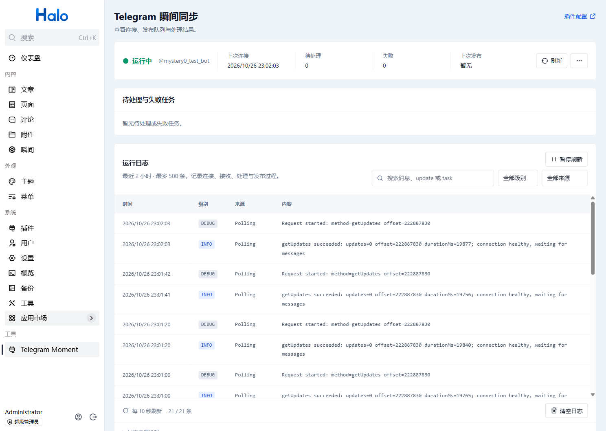

# Telegram 瞬间同步

将 Telegram 频道消息或指定用户的私聊消息同步到 Halo「瞬间」。支持文字、图片、视频、GIF、静态/视频贴纸和媒体组；编辑消息会更新原瞬间，保留资源名称和评论关联。

## 安装与配置

- Halo **2.22.11 或以上**，Java 21；先安装并启用瞬间 **1.15.0 或以上**。
- 在 Halo「插件」中上传正式构建的 `plugin-telegram-moment-1.0.0.jar` 并启用。
- 打开插件配置，在「Bot Token 凭据」中创建或选择 Secret，填写 `token` 键及 Bot Token；再填写发布者的 Halo 用户名、附件存储策略的资源名称。分组可留空。
- 频道模式下将 Bot 加入频道并授予读取消息所需权限。填写频道 Chat ID 可限定来源；留空接收该 Bot 能收到的所有频道消息。
- 私聊模式必须填写允许的发送者数字 ID，不能留空或填用户名。普通群、超级群和其他发送者不会发布。
- 打开「工具 → Telegram Moment」，在「更多」中选择「应用配置并重启」，确认状态为「运行中」。保存配置后需要重启 Bot 才会应用。

Token 由 Halo Secret 保存，普通配置只保存引用，管理页不返回凭据。修改 Secret 内容后同样需要重启 Bot。默认不向 Telegram 发送处理结果；需要回复时，在频道或私聊配置中主动开启，并给 Bot 相应发送/删除权限。已有配置的回复开关会保留。

API Endpoint 留空使用 `https://api.telegram.org`。代理端点需同时支持 Bot API 和文件下载路径，可包含由字母、数字、下划线和短横线组成的路径前缀。只支持 HTTPS、443 端口，默认仅连接公网地址，不跟随重定向。不要把 Token 写在端点中。自定义代理能接触 Bot Token 和消息，请选择自己信任的服务。

私网或 CGNAT 代理可在“可信端点地址”填写 `proxy.example.com=100.64.0.7`，将域名替换为自己的代理域名。每行或逗号分隔一个规则，最多 32 条，仅精确授权该域名对应的 IP；不支持通配符、CIDR、环回、链路本地或其他保留地址。支持 IPv4 私网、CGNAT 和 IPv6 ULA；证书校验保持启用。所有 DNS 结果都必须是公网或被该域名的规则授权，否则整次连接被拒绝。保存后重启 Bot 生效。

日志出现 `blocked by endpoint address policy` 时，按其中的数字地址检查 DNS 或添加准确的可信代理规则；不要仅因某个地址出现在 DNS 结果中就信任它。



## 同步规则

- 文本与 caption 转换为安全 HTML，支持常用文本格式、链接和 hashtag。屏蔽标签按完整 hashtag 匹配。
- 相册按照消息 ID 排序，使用第一个非空说明；聚合延迟默认 3 秒，可配置 1–60 秒。迟到成员会更新同一瞬间。
- 在**频道**中回复原消息发送 `/rm`，删除对应瞬间；回复相册任意已记录成员可删除整组。`/redo` 重新处理同一记录，不额外创建瞬间。
- 不支持音频、文档和 TGS 动画贴纸；单个媒体最大 20 MiB。不支持的媒体不会发布成空瞬间。
- Telegram Update 先持久化，再推进接收游标。发布自动重试最多 5 次；失败保留任务，可修复原因后手动重试。待处理与失败队列合计上限 1000。
- 附件上传失败保留原瞬间；成功提交新内容后才清理替换掉的旧附件。附件删除通过 Halo 的资源清理流程完成。
- 同步记录按 Bot ID 隔离，切换 Token 后不会用新 Bot 处理旧 Bot 的任务。已完成记录保留消息与相册映射，供后续编辑和删除使用。

重写版本识别旧版 `chatId`、`messageId` 和 `attachmentNames` 注解；首次编辑时接管旧瞬间。旧版本未保存的相册成员关系无法从 Telegram 历史自动重建。不要手工删除同步记录或瞬间来源注解，否则后续消息可能无法关联原内容。

## 运行状态与排错

管理页区分尚未配置、配置错误、运行、重连、停止和异常；请求失败不会伪装成停止。页面每 10 秒刷新，可查看最近连接、发布时间及失败原因。

启用页面日志后保留最近 2 小时、最多 500 条；Token 自动脱敏，日志不会记录完整消息。管理 API 需要登录及 `plugin:telegram-moment:manage` 权限。配置权限由 Halo 插件管理权限控制。

日志按阶段记录：`Connection` 为身份验证和连接恢复，`Polling` 为轮询数量、耗时、心跳和重试，`Receive` 为每条更新的接收/入队/忽略原因，`Media` 为下载和上传阶段，`Sync` 为发布、编辑、删除结果。使用 `update`、`message` 和 `task` 标识串联处理过程。正常空轮询每分钟记录一次心跳；需要逐次检查请求时开启调试模式并重启 Bot。

连接失败会说明超时、DNS、TLS 等可识别的原因，并给出检查方向；401 提示检查 Token，403 提示检查权限，409 提示检查重复轮询或 webhook，429 显示实际等待时间。任务失败会说明自动重试倒计时，或提示修复后手动重试。页面将时间、级别、阶段和详情分开显示，警告和错误分别高亮。

常见原因：发布者不存在、策略名不正确、瞬间未启用、网络无法访问 Telegram、Token 无效或同一个 Bot 被其他程序长轮询。`409` 通常应检查是否存在另一个 Bot 消费者。下载失败请同时检查代理的 `/file/bot...` 路径。

管理页暂显示前 100 条待处理/失败任务；超过时可通过管理 API 按任务名重试，或先处理当前显示的任务。Telegram 本身不无限期保留未消费 Update；插件长时间离线可能无法补齐全部历史。

## 通过 WSL Docker 构建

在项目根目录的 PowerShell 中执行：

```powershell
wsl --exec bash /mnt/d/IdeaProjects/halo-plugin-telegram-moment/scripts/build.sh '-Pversion=1.0.0'
```

其他路径请相应修改。脚本在同一容器中使用 Node 24、pnpm 10.12.4、Java 21 和 Gradle Wrapper 8.14.6，执行完整 `clean build`（前端测试、类型检查、打包及后端测试）。依赖缓存放在 Docker 卷内。最终 JAR 位于 `build/libs/`。发布流程见 [发布清单](docs/releasing.md)。

## 隔离集成测试

`scripts/mock_telegram.py` 模拟 Telegram HTTPS 协议，不连接真实 Telegram。**只在专用测试 Halo 使用集成脚本**：它会设置测试配置、创建/编辑/删除测试瞬间并上传测试附件。夹具在专用 Docker 桥接网络中模拟公网地址，只使用虚拟凭据；测试证书仅注入测试 Halo 信任库，插件本身没有安全绕过开关。

```bash
bash scripts/prepare-test-tls.sh
docker compose -p telegram-moment-store-test -f scripts/compose.test.yaml up -d
```

访问 `http://127.0.0.1:18092` 初始化 Halo，安装瞬间与本插件。将测试管理员凭据写入仓库外 JSON 文件（键为 `username`、`password`），在安装了 Python `cryptography` 的 WSL 中执行：

```bash
python3 scripts/integration_test.py --credentials /path/outside/repo/test-credentials.json
```

测试包含 Secret 迁移、无 `from` 频道消息、原位编辑、重复投递、相册成员编辑、删除、标签屏蔽、附件下载失败与手动重试、Bot 重启恢复和匿名访问保护。测试结束执行 `docker compose -p telegram-moment-store-test -f scripts/compose.test.yaml down` 停止专用实例，数据卷保留。设置环境变量 `HALO_VERSION` 可切换版本，应使用新的 Compose 项目数据卷验收，不能直接降级已有数据库。

设计、实施计划及实测记录位于 [docs/plans](docs/plans)。真实 Telegram Token 的验证与模拟服务验证分别记录，不以模拟测试代替真实网络验收。

## 隐私、升级与卸载

- 数据流向：Halo 主动向 Telegram（或指定代理）轮询消息、下载媒体；媒体再上传至选定的 Halo 附件存储。开启回复时会向 Telegram 发送处理状态。插件不包含遥测或第三方统计。
- 存储内容：Halo 保存 Bot Secret、配置、接收游标、消息及相册映射、任务内容、瞬间和附件。消息内容按配置发布为公开瞬间，启用前确认频道和私聊来源范围。
- 日志：开启页面日志后保留内存缓冲，最多 2 小时/500 条；运行信息也写入 Halo 服务日志，其保存时间由部署环境决定。日志包含消息 ID、任务 ID 和处理结果，不保存完整消息或 Token；关闭实例会丢失页面内存日志。同步记录为支持后续编辑而持续保存，不自动按日志保留期删除。
- 升级：先备份数据库和附件；旧版明文 Token 在 Bot 启动时迁入 Secret，验证成功后才移除旧字段。失败时 Bot 停止启动并提示检查凭据。旧版程序无法直接使用新引用，降级需要从备份恢复匹配配置。
- 停用：停止接收，不删除已有瞬间、附件或同步数据。卸载：插件不主动删除用户 Secret 或已发布内容；Halo 对插件扩展的清理由卸载选项决定。需要彻底清理时先备份、停用插件，再通过 Halo 管理界面检查并删除相关瞬间、附件、配置和不再被引用的 Secret。不要删除其他应用共用的凭据。
- 建议仅为专用 Bot 授予必要频道权限，并限定频道 ID；管理权限不额外授予 Secret 读取权限。

## 许可证

[GPL-3.0](LICENSE) © Mystery0
